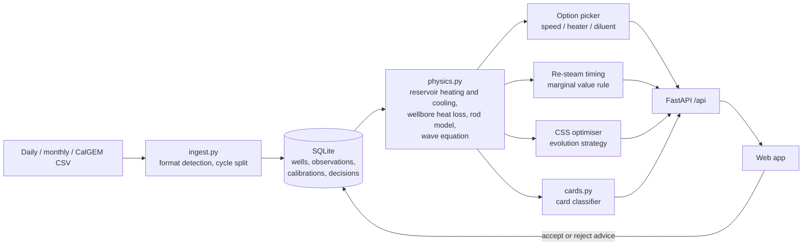

# ThermoStroke Twin

**A software digital twin that finds the cheapest safe way to the next barrel** for heavy-oil wells produced by
cyclic steam stimulation (CSS) and sucker-rod pumps (SRP).

Smart India Hackathon 2026, problem statement **26120** (Oil India Limited, Baghewala field). Team **NexaBuild**.

> **Read this first.** Baghewala field data is not public, so every well in this repository is **synthetic**, set to public
> Baghewala ranges (depth ~1,100 m, 10,000–13,000 cP at 50 °C, 46–48 °C reservoir). The card classifier is trained on
> **simulated** dynamometer cards. Numbers in the app show how the method behaves, not field results. Calibrate on
> Oil India data before any operational use.

## What it does

Every day, for every well, the twin forecasts how the heated zone cools and asks one question:
*what is the cheapest safe way to keep the next barrel flowing?*

| Option | How the twin models it |
|---|---|
| Pump speed and split stroke | Best SPM and downstroke share within Rod-Float Index 0.85 and 90% rod loading |
| Downhole heater | Warms the tubing ~30 °C, costs ~30 kW of power |
| Diluent 10% or 20% | Log-blended viscosity, costs ₹ per barrel of diluent |
| Re-steam now | Called when pumping on earns less per day than a fresh cycle averages (marginal value theorem) |

It also plans each well's next CSS cycle (steam volume, injection pressure, soak time, cut-off), re-fits itself after
every cycle, and draws surface and pump dynamometer cards from a finite-difference solution of the rod wave equation.

## Quick start

```bash
# Docker
docker compose up --build            # then open http://localhost:8000  (API docs: /docs)

# or locally (Python 3.11+)
cd backend
pip install -r requirements.txt
uvicorn app.main:app --reload        # http://localhost:8000
pytest -q                            # 21 tests
```

`frontend/index.html` also runs on its own with no server (the whole model runs in the browser). When it is served by
the backend it shows **Server connected** and adds a **Fit on the server** button.

## Architecture



## API

| Method | Path | What it returns |
|---|---|---|
| GET | `/api/health` | Status, number of wells, card-model accuracy |
| GET | `/api/wells?clock=0` | Every well on a given day: phase, temperatures, viscosity, oil, setpoints, RFI |
| GET | `/api/wells/{id}` | One well now, plus re-steam day and reason |
| GET | `/api/wells/{id}/forecast` | Twin vs field practice, day by day |
| GET | `/api/wells/{id}/options` | Cheapest way to the next barrel: every option plus the re-steam check |
| POST | `/api/wells/{id}/simulate-speed` | What-if: hold a speed, split and option; first day rods would float |
| POST | `/api/wells/{id}/card` | Wave-equation surface and pump cards plus the classifier's diagnosis |
| POST | `/api/wells/{id}/plan` | Best next CSS cycle vs the field rule (`goal`: `money` or `sor`) |
| POST | `/api/data/preview` | How an uploaded file was read (format, column mapping, cycles) |
| POST | `/api/data/upload` | Store one well's cycles (daily, monthly or CalGEM export) |
| POST | `/api/wells/{id}/calibrate` | Re-fit productivity, viscosity multiplier and early drive; saved per well |
| POST | `/api/fit` | Stateless fit of pasted CSV (used by the web app) |
| POST | `/api/wells/{id}/decisions` | Log whether an engineer accepted the advice |
| GET | `/api/decisions` | Audit trail |

## Real data: California CSS wells (CalGEM)

Baghewala data is not public, but California's regulator CalGEM publishes monthly **production and injection per well**,
including thousands of cyclic-steam (well type `SC`) wells in heavy-oil fields such as Kern River and Midway-Sunset.
That makes it the best public data for testing the learning twin on real cycles.

1. Download the yearly files from the WellSTAR public downloads page (conservation.ca.gov → CalGEM → Online Data).
   Post-2018 files are SQL Server backups; restore them in SQL Server Express and export the monthly production and
   injection tables to CSV.
2. Join production and injection by API number and month into one CSV with columns like
   `APINumber, ProductionReportDate, OilorCondensateProduced, SteamWaterInjected, DaysProducing`.
   Column names vary by year; `ingest.py` matches them by keyword (api, date, oil, steam/inject, days).
   `POST /api/data/preview` shows the mapping it used.
3. `POST /api/data/upload` with `source_well=<API number>`, then `POST /api/wells/{id}/calibrate`.

`data/samples/calgem_style_synthetic.csv` shows the expected shape (synthetic values, fake API numbers).

## How the numbers are checked

* **Browser and server agree.** `tests/test_parity.py` runs the same inputs through `frontend/src/model.js` (via
  `tools/make_fixtures.js`) and `backend/app/physics.py`: same day-by-day pump settings, options, cycle results,
  wave-equation loads and calibration.
* **Fast rod index vs full rod physics.** On 400 random speeds, stroke splits and viscosities, the fast
  Rod-Float Index correlates 0.94 with the wave-equation simulation, agrees on float vs no float in
  100% of cases, and never let through a case the full simulation floated (0 missed at the 0.85 limit).
* **Card classifier.** 98.0% of 880 held-out simulated cards classified correctly; 100% of rod-float
  cards caught. Retrain on OIL's labelled cards (`tools/train_cards.py`).
* **200 synthetic wells, twin vs field practice, same steam.** Wells with rod float: 84 → 0.
  Expected rod or pump jobs: 320 → 107. Lift energy per barrel: -37% (median).
  Oil per calendar day: +10% (median). Steam planner, "least steam" mode on 40 wells: steam per barrel -31% (median).
  These are model results on synthetic wells, not field results.

## Rebuild everything

```bash
node tools/make_fixtures.js          # browser-model reference outputs for the parity tests
node tools/gen_cards.js              # 4,400 wave-equation cards  -> tools/cards.json
python tools/train_cards.py          # card classifier            -> backend/app/card_model.json
node tools/evidence.js               # 200-well and 40-well tests -> frontend/src/evidence.json
python tools/build_frontend.py       # single-file web app        -> frontend/index.html
```
(Copy `backend/app/card_model.json` to `frontend/src/card_model.json` after retraining.)

## Repository

```
backend/app/     physics.py  ingest.py  cards.py  db.py  wells.py  main.py
backend/tests/   parity, physics, ingestion and API tests
frontend/src/    model.js (browser twin)  app.js  body.html  style.css  evidence.json  card_model.json
frontend/        index.html (built)
tools/           fixtures, card generation, classifier training, evidence runs, frontend build
data/samples/    synthetic daily, monthly and CalGEM-style files
```

## Limitations and next steps

* Synthetic wells only; calibrate on OIL production, CSS and SRP history (and validate on CalGEM cycles meanwhile).
* The reservoir model is analytical (Marx–Langenheim heating, Boberg–Lantz cooling), not a full thermal simulator.
* The card classifier is trained on simulated cards; swap in real labelled cards and a CNN for the finale.
* Advisory mode first: setpoints go to engineers, not straight to the VFD, until the twin is trusted.

Parts of this code were written with AI assistance.

MIT licence.
